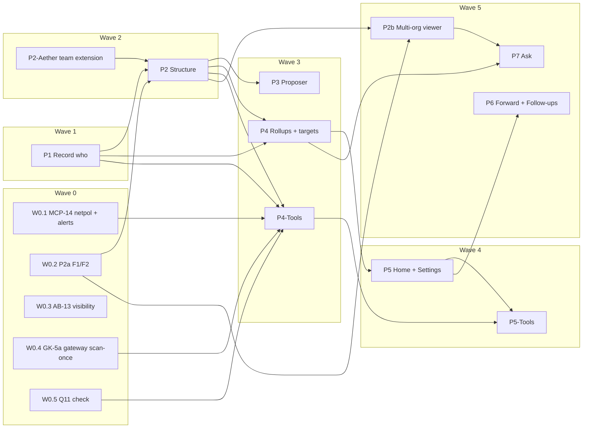

# Plan #22 Implementation Plan: Org Structure, Attribution, Tool Visibility and the Widget Home

```yaml
design: data-models/aiqg/org-structure-and-attribution.md (v0.7.0, D1-D17)
wireframe: https://claude.ai/artifact/RC6zR1NmaYeNwKFVQxyCWb
plan_ref: CLAUDE-PLANS-BACKLOG.md Plan #22
status: proposed 2026-11-19
repos: aiqg-dashboard-be, aiqg-ui, tas-llm-router, tas-mcp, tas-mcp-servers, Gatekeeper, aether-be, aether, tas-agent-builder, aiqg-import, tas-spark-jobs, aether-shared
```

## 1. What this plan does

The design doc says *what* to build and *why*. This plan says *in what order*, *in which pull requests*, *how each one is proven*, and *what can go wrong*. Each work package below names its repo, branch, files, migrations, tests, deployment and the check that closes it.

It splits the work into five waves. Each wave ends with a milestone you can see in the product:

| Wave | Milestone | What you can see when it lands |
|---|---|---|
| **0 Stop the bleeding** | M0 | The MCP proxy reaches all 12 servers again and alerts when it can't. No cross-tenant user list. Agent sharing can mean "my org". The gateway stops re-scanning the same message every turn. |
| **1 Record who** | M1 | Every gateway event, imported session and SDLC turn says which token and which person sent it. |
| **2 Structure** | M2 | TAS is an org in Aether with product teams. Tokens are placed in teams. Billed totals per team add up to the tenant total, to the cent. |
| **3 Measure** | M3 | Per-team rollups, targets and statuses. Tool calls are events with outcome, speed and findings. Server health comes from probes, not CR status. |
| **4 Show** | M4 | The new widget Home with role defaults and Customize. Analysis ▸ Tools. Settings ▸ Organization. |
| **5 Act** | M5 | Forward and Follow-ups, the multi-org viewer, then ✦ Ask. |

## 2. Ground rules for every PR

- **Branches:** one feature branch per work package, never `main`. No `git stash`.
- **Merging:** merge only after reading the CI checks back as passing (`gh pr checks`). Empty `--watch` output does not count. Where a repo has no CI (`tas-mcp-servers`), the PR body records the local `make test` output.
- **Change additively:** every schema and wire change is additive. New JSON fields are ignored by old readers, and new columns are nullable. Nothing is dropped until a later PR, after the new path has run in production for a week.
- **Flags:** each new behaviour ships behind a flag that is off by default. It is turned on in a separate deploy step, so the code and the switch never roll back together:

  | Flag | Service | Gates |
  |---|---|---|
  | `ORG_STRUCTURE_ENABLED` | aiqg-dashboard-be | P2 APIs and the history consumer |
  | `AETHER_ORG_EVENTS_ENABLED` | aether-be | publishing `aether.org.changes.v1` |
  | `TOOL_EVENTS_ENABLED` | tas-llm-router, tas-mcp | emitting `com.tas.aiqg.tool_call.v1` |
  | `ATTESTATION_STORE=redis` | Gatekeeper consumers | shared-store scan skipping |
  | `PROXY_AUTH_MODE=observe` | tas-mcp | resolving `TAS-Auth` without refusing anything |
  | `VITE_HOME_WIDGETS` | aiqg-ui | the new Home (old Home stays one click away) |
  | `MULTI_ORG_VIEWER` | aiqg-dashboard-be | per-request tenant selection |
- **Versions:** each image gets a semver bump in the repo's single version source, with OCI labels. No floating tags. Roll **both** aiqg-dashboard-be deployments, internal and public. Before rolling aiqg-ui, diff the baked `VITE_*` variables against the image it replaces.
- **Verifying:** read logs through Loki, never `kubectl logs`. Use `--cacert` with the private CA, never `-k`.
- **Backlog:** when a PR merges, update `BACKLOG.md` and the published backlog artifact in the same session, then run `sync-to-repo.sh`.
- **Tests:** a phase is not done while any test fails.
- **Match live first** (added 2026-11-19). `kubectl apply -k` applies the whole tree, not the line a PR changed, so any gap between main and the cluster ships along with the fix. On 2026-11-19, `kubectl diff` of main against the cluster found three trees where that would do harm (W0.0). So any PR that changes a deployment tree:
  1. **Starts with a match-live commit.** It changes main to describe what is running, with no behaviour change, and is proven by `kubectl diff` exiting **0**. Exit 2 means the tree could not be evaluated. That is not clean, and it hides drift, so resources whose CRDs are not installed go into an optional overlay first.
  2. **Then makes the real change.** `kubectl diff` now shows only that change, and the PR description includes the output.
  3. **Applies only that output**, after merge, and confirms the next `kubectl diff` exits 0.

  A tree with cosmetic drift only (a digest written as `tag@digest`, env order, labels) still gets the match-live commit. Doing so makes the next PR's diff readable.

## 3. Dependency graph



**Critical path:** P1 → P2-Aether → P2 → P4 → P5. Wave 0 runs alongside P1 and blocks none of it. P4-Tools can start once P1 and P2 merge and run in parallel with P4. P2b is needed only for the all-orgs Home. TAS has one org today, so P5 ships single-org first and the all-orgs cards follow P2b.

## 4. Gaps found while planning (fixed in the design doc with this plan)

| # | Gap | Fix |
|---|---|---|
| G-1 | Six `CREATE TABLE` blocks had the column comma *inside* the `--` comment (`team_id UUID -- Aether team id,`). As written, they are syntax errors. | Fixed in the design doc. The migrations below use the corrected SQL. |
| G-2 | `team_member_history.member_kind` did not allow `mcp_server`, although §9.5 relies on it. | Added to the CHECK in the design doc. |
| G-3 | `org_target.unit_id` is a UUID, so it cannot hold the per-server and per-tool targets §9.5 asks for. | P4-Tools adds `subject_kind ('unit','mcp_server','tool')` and `subject_key TEXT`. `unit_id` becomes nullable when `subject_kind <> 'unit'`. |
| G-4 | §9.5 names only the `tool_call_1h` aggregate, with no raw table under it. | Timescale migration 009 adds a raw `aiqg.tool_call_events` hypertable with 90-day retention, like `event_metrics`. |
| G-5 | P1 omits tas-spark-jobs, yet the job is what maps response-event fields into `event_metrics`. | Added to P1 as WP1.4. |
| G-6 | Counting each finding once changes historical Data-safety numbers: they drop when GK-5 turns on. | Charts mark the change date. Reports show "counted once since <date>". The old metric stays queryable for 30 days. |

## 5. Wave 0: stop the bleeding (start now; independent)

### W0.0 Match-live inventory (found 2026-11-19)

| Tree | What applying main would do today | Match-live commit | Before |
|---|---|---|---|
| `tas-mcp/k8s/overlays/prod` | It would roll 5 pods onto `:latest` (live is `obs-20260817`, digest `e2dffe1a…`). It would create a public Ingress for `api/grpc.tas-mcp.com` with `letsencrypt-prod`. It would drop four port-8082 ingress rules that were patched in by hand on 2026-02-06. And it cannot be diffed at all, because the VPA and ServiceMonitor CRDs are not installed. | Pin the running digest. Remove the Ingress. Carry the 8082 rules. Move the VPA and ServiceMonitor to an optional component. | W0.1 |
| `tas-agent-builder/k8s` | It would move the Deployment and the model-migration CronJob to `:latest`. | Pin `spaceiso-892ff8f` and `agent-builder:model-fallback-20260427211530` as running. | W0.3 |
| `tas-mcp-servers/k8s` | It would remove `MCP_COMMAND` from the kafka-mcp bridge, which breaks that server. It would move podcast-mcp from `v2.2.1` to `1.0.0`. The rest is labels and the `BRIDGE_VERSION` env var. | Restore `MCP_COMMAND`. Decide which podcast-mcp tag is intended. Match labels and env. | T.4 |
| aiqg-dashboard-be, aiqg-ui, tas-llm-router, aether-be | Cosmetic only. | Folded into each tree's first plan PR. | that PR |

### W0.1 MCP-14: the proxy can reach its servers again

- **Repo / branch:** `tas-mcp`, `fix/mcp-14-netpol-egress`
- **Commit 1, match live** (W0.0): `kubectl diff` exits 0.
- **Commit 2, change:**
  - `k8s/base/networkpolicy.yaml`: allow egress to namespace `tas-mcp-servers` on any TCP port, and to `tas-shared` Redis on 6379.
  - Allow by namespace selector, not port list. The port list is what broke.
- **Alerting:**
  - `aether-shared` gets a Loki ruler or Prometheus rule: "redis set: connection refused" above 10 a minute for 10 minutes means page.
  - The first Prometheus counter in tas-mcp, `tas_mcp_upstream_errors_total{server_id,kind}`, plus a scrape config.
- **Verify:**
  - `bash </dev/tcp` from the pod to each of the 12 servers.
  - In Loki, the refused-connection lines drop to 0 within 15 minutes of the roll.
  - One tool call per server through the proxy returns `ok`.
  - The 7-day "boundary scan findings" count is no longer stuck at 0. If it stays 0 with traffic flowing, that is a separate finding.
- **Size:** S (0.5 to 1 day). **Risk:** low. It widens egress only inside the cluster.

### W0.2 P2a: admin-surface fixes F1 and F2

- **Repo / branch:** `aiqg-dashboard-be`, `fix/admin-users-tenant-scope` (one PR, two commits)
- **F1:**
  - `internal/handlers/admin.go` `listUsers` filters on the Keycloak attribute `tenant_id` equal to the caller's JWT tenant.
  - New realm role `aiqg-platform-operator` for the platform-wide list.
- **F2:**
  - `admin.role.granted` and `admin.role.revoked` are appended to `aiqg.audit_log` in the same request, fail-closed.
  - The entries are documented in `aether-shared/data-models/aiqg/audit-log-entry.md` (companion PR).
- **Tests:** a two-tenant handler test checks that an admin of A sees no user of B. A failed audit write returns 500 and the role is not changed (fake Keycloak).
- **Deploy:** roll both deployments. Create and assign `aiqg-platform-operator` before rolling, or John loses the cross-tenant list.
- **Size:** S (1 to 2 days).

### W0.3 AB-13: agent visibility `private | organization | public`

- **Match live first** (W0.0): the first commit pins the images that are running now.
- **Repo / branches:**
  - `tas-agent-builder`, `feat/ab-13-agent-visibility`
  - `aether`, `feat/agent-visibility-select`
  - `aether-be`, `feat/agent-visibility-mirror`
- **Migration `023_agent_visibility.sql`:**
  - `visibility TEXT NOT NULL DEFAULT 'private' CHECK (...)`;
  - backfill `is_public = true` to `public`, which today is only the 16 system agents;
  - keep `is_public` as a generated column for one release, then drop it.
- **Read rule** (`services/impl/agent_service_impl.go:38-43`, `:425-427`, `:473-474`):
  ```
  (owner_id = ? AND space_id = ?) OR is_internal
  OR visibility = 'public'
  OR (visibility = 'organization' AND tenant_id = <caller tenant>)
  ```
  Setting `public` requires an admin role.
- **UI:** the "Make public" toggle becomes a three-way select, with "My organization" as the default share.
- **Tests:** two tenants. An `organization` agent is readable in A and not in B. A non-admin who sets `public` gets 403. Duplicating and listing follow the same rule.
- **Size:** M (2 to 3 days).

### W0.4 GK-5a: the gateway scans each message once

- **Repo / branches:** `Gatekeeper` `feat/attest-shared-store`, then `tas-llm-router` `feat/gk-5-gateway-scan-once`.
- **Gatekeeper:**
  - A `pkg/attest` Redis-backed `Cache` beside `cache_impl.go`.
  - Key `attest:{tenant}:{sha256(normalised)}:{profile}:{ruleset_version}`.
  - 24-hour TTL, refreshed on each hit.
  - `RulesetVersion()` on the engine.
  - A per-message `ScanMessages` that returns which messages were skipped.
  - Normalisation: Unicode NFC, trimmed trailing whitespace, nothing else.
- **Router** (`internal/gatekeeper/gatekeeper.go`):
  - `EnableAttestation` from config.
  - Scan per message; drop the second redaction scan at line 401.
  - Add `scan_skipped`, `scan_ms` and `attestation_hits` to the response event.
  - Count a finding once per `(tenant, content_hash, pattern)`.
- **Fail safe:** on a Redis error or timeout (20 ms budget), scan anyway. A missing attestation can only cost time, never a missed finding.
- **Tests:**
  - A 10-turn conversation scans message 1 once, and its finding is counted once.
  - Changing the rules re-scans.
  - Another tenant with the same content does not skip.
  - A Redis outage still scans everything.
  - Benchmark the p95 scan time before and after on a 20-turn replay.
- **Verify:** replay a real Claude Code session (Plan #18 capture) through `llm-router-aiqg`. Loki shows `scan_skipped` rising per turn, and Data-safety counts match a hand count.
- **Size:** M (3 to 4 days). See G-6 for the reporting change.

### W0.5 Answer Q11: does the gateway scan `role: tool`?

Read the router's message walk and send one test request carrying a fake card number in a `role: tool` message. The answer decides whether P4-Tools has to *re-credit* tool-result findings or *add* them. No PR; record the answer in the design doc §14.2.

## 6. Wave 1: P1 Record who

Merge in this order. Each PR is safe on its own.

| WP | Repo / branch | Change | Migration |
|---|---|---|---|
| 1.1 | aiqg-dashboard-be `feat/p22-token-owner` | `aiqg.token` gains `owner_sub` and `owner_email`. Issue sets them from the JWT. A one-shot backfill from `audit_log` (`token.issued`). `/internal/auth/validate` adds `label` and `owner_sub`. | `052_token_owner.sql` |
| 1.2 | aiqg-dashboard-be `feat/p22-import-uploader` | `imported_trace` gains `uploaded_by_sub` and `uploaded_by_token_id`. `sdlc_turn` gains `actor_sub`, copied at extraction. | `053_actor_columns.sql` |
| 1.3 | aether-shared `feat/p22-event-metrics-owner` | `event_metrics` gains `token_id UUID` and `owner_sub TEXT`. Update `token.md`, `response-event.md`, `request-event.md`. | Timescale `007_event_metrics_token_owner.sql` |
| 1.4 | tas-spark-jobs `feat/p22-map-token-owner` | `aiqg_aggregator/schema.py` and `main.py` map `tas_auth_token_id` and `token_owner_sub` from the response event. | n/a |
| 1.5 | tas-llm-router `feat/p22-response-token-owner` | Decode `label` and `owner_sub` into `tokens.Token`. Stamp both on the **response** event and promote them to the Loki line. | n/a |
| 1.6 | aiqg-import `feat/p22-uploader` | The code adapter sends the token. `Subject.OSUser` and `Machine` are sent as hashes only. | n/a |

- **Order:**
  - 1.3 must apply before 1.4 deploys, or the job writes to columns that do not exist.
  - 1.1 must deploy before 1.5, though 1.5 tolerates the missing fields.
- **Verify** (design §13):
  - Issue a token and send two requests, one with `baggage: user.id=…` and one without.
  - Both events carry `token_id` and `owner_sub` in Timescale and Loki. Only the second carries `user_id`.
  - The backfill count equals the number of `token.issued` rows whose token still exists. Record both numbers in the PR.
- **Closes:** Plan #11 Phase 2. `/me/usage` filters on `owner_sub`.
- **Size:** M (5 days total).

## 7. Wave 2: structure

### P2-Aether: extend Aether's Team (aether-be, aether, aether-shared)

| WP | Branch | Change |
|---|---|---|
| A.1 | `fix/no-delete-all-teams` | **First, on its own.** `deleteOrganizationInternal` archives teams instead of `DETACH DELETE`. `scripts/setup-demo-data.go` deletes only nodes tagged `demo=true`, never every `Organization` or `MEMBER_OF`. |
| A.2 | `feat/team-nesting` | `CHILD_OF` (one parent, same org, cycle check on write), `BELONGS_TO`, `slug` (unique per org), `archived_at`. Neo4j constraints and indexes. |
| A.3 | `feat/team-joining` | `visibility` covers joining: self-join on `organization`, a request queue on `private`. Back-dated `joined_at`, settable by the team owner or admin. Joining a team adds an implied org `member` edge. |
| A.4 | `feat/org-change-events` | Publish `aether.org.changes.v1` for every team and org-member mutation. Use an outbox node written in the same Neo4j transaction, with a relay goroutine, so an event is never lost or invented. The aether-shared PR adds the topic to `kafka-topics-job.yaml` and documents the schema in `data-models/aether-be/`. |
| A.5 | aether `feat/team-nesting-ui` | The team page shows the tree, the join button, the request queue and the "since" date. Redux slice updates. |

- **Tests:**
  - Unit tests for the cycle check.
  - The org-delete integration test now asserts teams are archived, not deleted.
  - Outbox relay: kill the relay between write and publish, then restart. The event arrives exactly once (consumers dedupe on `event_id`).
- **Size:** L (8 days).

### P2: structure in AIQG (aiqg-dashboard-be, aether-shared)

| WP | Branch | Change | Migration |
|---|---|---|---|
| 2.1 | `feat/p22-account-aether-link` | `aiqg.account` gains `kind`, `aether_org_id`, `aether_tenant_id` and `aether_user_id`. Link `65ea3247…` to the TAS org. Add a nightly drift check with a Prometheus gauge `aiqg_org_link_drift`. | `054_account_aether_link.sql` |
| 2.2 | `feat/p22-team-history` | `team_history` and `team_member_history` (with `mcp_server`). A Kafka consumer that is idempotent on `event_id`. First sync from the Aether API. A nightly reconcile that reports drift and never overwrites. | `055_team_history.sql` |
| 2.3 | `feat/p22-token-placement` | `token_placement` and `person_default_team`. `PUT /tokens/:id/placement` and `PUT /org/people/:sub/default-team`, with fail-closed audit. The report-under resolver goes in `internal/orgattr/` as one function used by every query. | `056_token_placement.sql` |
| 2.4 | `feat/p22-workflow-owner` | `workflow_owner` and its `PUT`. | `057_workflow_owner.sql` |
| 2.5 | `feat/p22-org-api` | `GET /org/teams`, `GET /me/scope`, `PUT /org/user-keys/:key`, `GET /org/actors/unassigned`, and the aether-be team proxy that calls Aether with the user's token. | n/a |
| 2.6 | aether-shared `docs/p22-account-md` | Correct `account.md`: the Space binding was never built, so replace it with the §5.0 link. | n/a |
| 2.7 | ops, no PR | Seed the TAS org in Aether through its API: Engineering plus the seven product teams with their repos (design §5.3). Place the Plan #18 dogfood token under Engineering and the demo tokens under AIQG. | n/a |

- **Verify** (design §13):
  - The TAS tenant's Billed total for last month equals the tenant total, to the cent.
  - A person in two teams shows in both under Involving and once under Reported-under.
  - A token placement back-dated to the token's creation moves its whole history in one refresh.
  - Two-tenant tests on every new endpoint.
- **Size:** L (8 days).

## 8. Wave 3: measure

### P3: infer, then confirm (aiqg-dashboard-be `feat/p22-proposer`)

- **Migration:** `058_org_proposal.sql`, plus `tenant_ticket_prefix` (the per-tenant prefix → unit map that replaces the hard-coded regex at `internal/sdlclabel/workflows.go:48`).
- **Proposer:** the seven rules as a nightly job (`internal/orgproposer/`) and an on-demand endpoint. Evidence holds ids and counts only. A rejected proposal is not raised again for the same evidence hash.
- **Reuse:** AIQG-71 (inferred session names) moves onto the same table in a follow-up PR.
- **Tests:** a golden fixture per rule. Rejecting a proposal and re-running the job produces no duplicate.
- **Size:** M (4 days).

### P4: rollups and targets

| WP | Repo / branch | Change |
|---|---|---|
| 4.0 | none (measurement) | **Q3:** count distinct `(bucket, token, owner_sub, user_id, agent, source_app, workflow, vendor, model)` per hour over 14 days of traffic, and choose the fold threshold N. **Q4:** check that `event_metrics.tags` names the data type per event. If it doesn't, add a router WP that emits the pattern category. Record both answers in the design doc. |
| 4.1 | aether-shared `feat/p22-actor-1h` | Timescale `008_event_metrics_actor_1h.sql`: the continuous aggregate, its refresh policy and no retention. **Never refresh with a NULL start** (see `project_customer_data_mcp`). Backfill in 7-day windows. |
| 4.2 | aiqg-dashboard-be `feat/p22-targets` | `059_org_target.sql` (with G-3's `subject_kind` and `subject_key` from the start). `PUT /org/teams/:id/targets/:metric`. A status engine in `internal/orgstatus/`: red, amber, green or none, and a Spend run-rate projection. |
| 4.3 | aiqg-dashboard-be `feat/p22-units-api` | `GET /metrics/units?view=billed\|reported\|involving\|served`. The data-safety-by-app query. `GET /home` with `widgets=` returning one section per widget, each computed by its drill target's query. |

- **Verify:**
  - Spot-check five units: `/metrics/units` against a hand-written SQL over raw `event_metrics` for the last 7 days, to the cent and the request.
  - Status turns red when a target is set just below the actual value, and loses its colour when the target is cleared.
- **Size:** L (7 days).

### P4-Tools: the tool layer

This wave assumes W0.1 (MCP-14), W0.4 (GK-5a) and W0.5 (Q11) are done.

| WP | Repo / branch | Change |
|---|---|---|
| T.1 | tas-mcp `feat/proxy-caller-identity` | The proxy reads `TAS-Auth` and `baggage`, resolves the token through `/internal/auth/validate` with a 60 s cache, and carries the identity in context. Mode `observe`: a call without a token is served as `(unattributed)`. Refusal is a later per-tenant setting (Q12). |
| T.2 | tas-mcp `feat/tool-call-events` | Emit `com.tas.aiqg.tool_call.v1` from the federation call path: server, tool, duration, outcome, result bytes and tokens, reduced bytes, and findings by category (taken from the G2 scan, not a second scan). Uses aether-shared `go-events`. Add Prometheus histograms `tas_mcp_tool_call_seconds{server_id,tool,outcome}`. |
| T.3 | tas-mcp `feat/gk-5b-proxy-attest` | Write an attestation for each scanned tool result to the shared store, and for the *output* hash when the result was redacted. |
| T.4 | tas-mcp `feat/server-probes` + tas-mcp-servers `feat/operator-reachability` (match-live commit first, W0.0) | Probe each server every 60 s with `initialize` and `tools/list`. The gauge `tas_mcp_server_up{server_id}`. The `tools/list` result is snapshotted into the catalogue. The operator sets the CR condition `Reachable` from the probe; `Registered` alone no longer reads as healthy. |
| T.5 | tas-llm-router `feat/tool-call-events` | From the request, the offered tool names and the schema byte size. From the response, `tool_calls` (one event per call, with `observed_by=gateway`). `no_result` is detected in the flow linker (`builder.go:291-346`) when the flow closes without the echoed `tool_call_id`. |
| T.6 | aether-shared `feat/tool-call-timescale` | Timescale `009_tool_call.sql`: the raw hypertable `tool_call_events` (90-day retention, G-4), `tool_call_1h` (§9.5 group-by, with a p95 sketch via `percentile_agg`), and `tool_catalogue` (snapshot rows). Topic and schema docs. |
| T.7 | tas-spark-jobs `feat/tool-call-events` | Route the new event type to `tool_call_events`. Join proxy and gateway rows on `tool_call_id`; when both exist, the proxy's fields win and `observed_by=both`. |
| T.8 | aiqg-dashboard-be `feat/p22-tools-api` | `GET /api/v1/tools` (servers, tools, the six metrics), `/tools/servers/:id`, `/tools/never-called` (a nightly job comparing the catalogue with calls), and `/tools/findings`. `mcp_server` members, so each server has an owning team. Tool targets with defaults (Uptime ≥ 99%, p95 < 5 s, zero high-severity findings). Tool problems feed Needs your attention. |

- **Verify:**
  - Send one call per outcome on purpose: ok, tool_error, timeout (a slow fake server), unreachable (scale a server to 0), blocked (a policy hit) and no_result (drop the result in the client).
  - Each one lands in `tool_call_events` with the right `observed_by`.
  - Scaling napkin-mcp to 0 turns it red in the API within 2 minutes, and it shows in Needs your attention with the MCP team as owner.
  - One email in a tool result, carried through a 10-turn conversation, is counted exactly once.
- **Size:** XL (12 days). It splits cleanly: T.1 to T.4 in tas-mcp, T.5 in the router, T.6 to T.8 in data and API.

## 9. Wave 4: show (aiqg-ui)

### P5: widget Home and Settings

| WP | Branch | Change |
|---|---|---|
| 5.1 | `feat/home-widget-framework` | `src/home/`: a widget registry (`type → {component, sizes, roles, drillTo}`), a 12-column grid, and the Redux slice `homeLayout` (layout, edit mode, resolved source). System default layouts per role, versioned in code. One `/home?widgets=` call per page. Unknown widget types are skipped. The old Home stays at `/home/classic` behind `VITE_HOME_WIDGETS`. |
| 5.2 | `feat/home-widgets-core` | Needs your attention, Your orgs/teams, CLEAR scorecard (rank switch without Tools for now), Data safety (prompts half), Spend and forecast, Savings, Adoption, Vendor mix, Compliance posture, Visibility, Follow-ups (a placeholder until P6), My usage. Each one links to its drill target. Phone layout is a single column with top-3 lists. |
| 5.3 | `feat/home-customize` + be `feat/p22-home-layout` | Edit mode: drag, keyboard move, size, remove, the grouped Add-widget picker, Reset. Backend `060_home_layout.sql` (with `home_pin`), `GET/PUT /home/layout`, and `PUT/DELETE /org/home-default` with fail-closed audit. |
| 5.4 | `feat/settings-organization` | The team tree (read from `/org/teams`; edits go through the Aether proxy), members with "since", token placement, default team, targets per unit, Unassigned (ordered by cost), and the proposal queue. |
| 5.5 | `feat/token-dialog-org-team` | The token issue dialog gains Org (required, or Personal) and Team (optional). A unit filter in Traffic Explorer and Engineering. An owner column on workflows. |

- **Tests:**
  - Vitest for the layout resolver (user → org default → system) and for skipping unknown widgets.
  - Reducer tests for `homeLayout`.
  - For each widget, check that the number on Home equals the number on its drill page for the same scope and period. This contract test runs against a fixture API response.
- **Verify:**
  - Sign in as John: the executive default renders with real data.
  - Customize, reload, and the layout persists.
  - Reset brings back the default.
  - A member account sees the member layout and no person rows (D11).
- **Size:** XL (12 days).

### P5-Tools: Tools page and tool widgets

| WP | Branch | Change |
|---|---|---|
| 5T.1 | `feat/analysis-tools-page` | `/tools` under Analysis, after Traffic Explorer (`src/config/nav.ts`). It has a coverage banner (proxy vs gateway-only, attestation skip rate), six KPIs, the server ▸ tool table, probe history, Never called and Data safety in tool results. Follows the wireframe's section 4. |
| 5T.2 | `feat/home-tool-widgets` | The Tools (MCP) overview (M, executive default), Tool health (S, owner and manager defaults), the tool-results half of Data safety, Tools in the CLEAR rank switch, and a Tools row on org cards. Bump the system default layout version so existing users get the new widget without losing their own changes. |

- **Size:** M (5 days).

## 10. Wave 5: act

### P2b: multi-org viewer (aiqg-dashboard-be, aiqg-ui)

- **Middleware:** `internal/middleware/auth.go` reads the active tenant from `X-AIQG-Tenant`, falling back to the JWT claim. Membership is validated per request against the `team_member_history` copy (org roles), with a 30 s cache. A wrong tenant gets 403 and is audited.
- **All orgs:** `/home?scope=all` fans out one scoped query per org.
- **UI:** an org switcher in the header and the "All my orgs" card row.
- **Gate:** a security test suite with two orgs and three users (member of A, owner of both, `aiqg-admin`). It walks **every** route in the router table, not a hand-picked list, and asserts that A's member gets nothing of B. It runs in CI.
- **Rollout:** behind `MULTI_ORG_VIEWER`. Turn it on in the public deployment only after a review of the route-walk test output.
- **Size:** M (5 days). Risk: **highest in the plan.**

### P6: Forward and Follow-ups

- **Backend:** `061_followup.sql`. `report_snapshot` gains `kind: home_drill`. `POST/GET /followups` and `/followups/:id/events`. Email through the existing mail worker. Overdue items feed the sender's Home.
- **UI:** a Forward dialog on Needs your attention, on every widget row and on drill pages. A Follow-ups page (To me, From me, Cc) with snapshot vs live. A count in the header.
- **Weekly digest (§11.3):** only if Q6 is agreed; one template.
- **Verify:** forward a real red item from John to a test manager account. The email arrives, the snapshot numbers match the moment of sending, and acknowledge → resolve → close works.
- **Size:** M (6 days).

### P7: ✦ Ask

- **Plan #20 Phase 1 tools:** land #178 first. Then add tools for quality/CLEAR by unit, exposure by app and type, follow-ups and the unit tree.
- **Model loop:** in aiqg-dashboard-be, calling through our gateway with an org service token per org, so Ask's own cost shows on that org's Home.
- **Scope:** viewer scope is injected into every tool call, and multi-org questions fan out per tenant.
- **Provenance:** "How I got this" on every answer. Refuse to answer without at least one tool call.
- **UI:** the panel, suggested questions, and Pin (an `ask_pin` widget), Show as view and Forward.
- **Tests:** a red-team set of 20 questions that try to reach another org, another person (D11) or raw prompt text. All must refuse or answer within scope.
- **Size:** L (8 days).

### P8 (future) and P9 close-out

- **P8:** recommended actions, per design §14.1. Not scheduled.
- **P9:** model docs, the backlog and its artifact, and the wireframe marked "as built". This is done continuously; each PR updates its own docs.

## 11. Effort and sequence

Sizes are rough engineer-days for one person working with Claude, and include review and deploy:

| Wave | Packages | Days | Can run in parallel with |
|---|---|---|---|
| 0 | W0.1-W0.5 | 8 | Wave 1 |
| 1 | P1 | 5 | Wave 0 |
| 2 | P2-Aether, P2 | 16 | P2a tail |
| 3 | P3, P4, P4-Tools | 23 | each other, after P2 |
| 4 | P5, P5-Tools | 17 | P4-Tools tail |
| 5 | P2b, P6, P7 | 19 | each other |
| **Total** | | **≈ 88** | about 10 to 12 calendar weeks with the parallelism above |

**Suggested first two weeks:** W0.1 (day 1), W0.2, W0.5 and WP1.1 to 1.3, then W0.3, W0.4 and WP1.4 to 1.6. Start A.1 (stop deleting teams) in week 2. It is small and protects everything after it.

## 12. Risks

| Risk | Where | Mitigation |
|---|---|---|
| A cross-tenant read through the new viewer | P2b, P7 | A route-walk test over every route in CI; a flag; one tenant per query, never two; Ask scoped server-side, never by the prompt |
| Aether and the AIQG copy drift | P2 | An outbox in Aether (no lost events), idempotent consumers, a nightly reconcile that *reports* and never overwrites, and a drift gauge with an alert |
| Rollup cardinality blows up | P4 | Measure first (4.0); fold rare `user_id` values into `(other)`; refresh windows bounded, never a NULL start |
| A false scan skip hides a finding | W0.4, T.3 | Tenant, profile and ruleset in the key; fail-open to scanning on any store error; a test that a rule change re-scans |
| Data-safety numbers drop when count-once ships | W0.4 | An annotated change date; the old metric stays queryable for 30 days; release note to John before turning it on |
| The new Home disagrees with its report | P5 | Each widget is computed by its drill target's query, enforced by a contract test |
| Widening the netpol opens more than intended | W0.1 | Egress by namespace selector only to `tas-mcp-servers` and Redis; no `0.0.0.0/0` |
| Single-node capacity during rollouts | all | BestEffort QoS per the cluster policy; roll one deployment at a time |
| The aether-be CI MinIO pull breaks red builds | P2-Aether | Check the job logs. A red `Start MinIO` proves nothing about the code; fix CI first if it recurs |

## 13. Decisions needed, and when

| Q | Question | Needed before | Proposed answer |
|---|---|---|---|
| Q7 | Who may create orgs? | P2 (2.7) | Any signed-in person, as in Aether today |
| Q3 | `user_id` fold threshold | P4.1 | Measured in 4.0 |
| Q4 | Does `tags` carry the data type? | P4.3 | Measured in 4.0 |
| Q11 | Gateway scans `role: tool`? | P4-Tools | Answered by W0.5 |
| Q12 | Refuse untokened proxy calls? | T.1 | No; observe by default, refusal per tenant later |
| Q9 | Do team viewers see person rows? | P5.2 | No, totals only, matching D11 |
| Q6 | Weekly digest? | P6 | Yes; one template on the Home endpoint |
| — | Turn on `MULTI_ORG_VIEWER` publicly | P2b rollout | After the route-walk review |

## 14. Done means

- Every phase's verification in this plan has been run and its output recorded in the PR.
- The design doc's status moves to `built` section by section.
- `BACKLOG.md` and the backlog artifact show Plan #22's phases resolved, with what was verified.
- A CEO signing in lands on the executive Home and sees:
  - which org or team missed a target;
  - whether the tool layer is healthy;
  - what sensitive data came in, and from where.

  From there they can forward a problem to its owner in two clicks.
